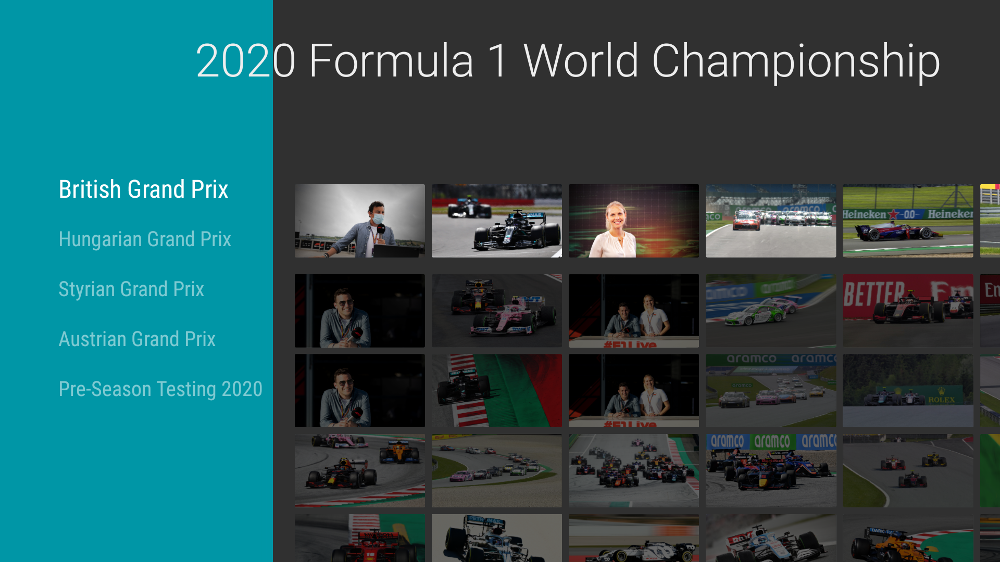
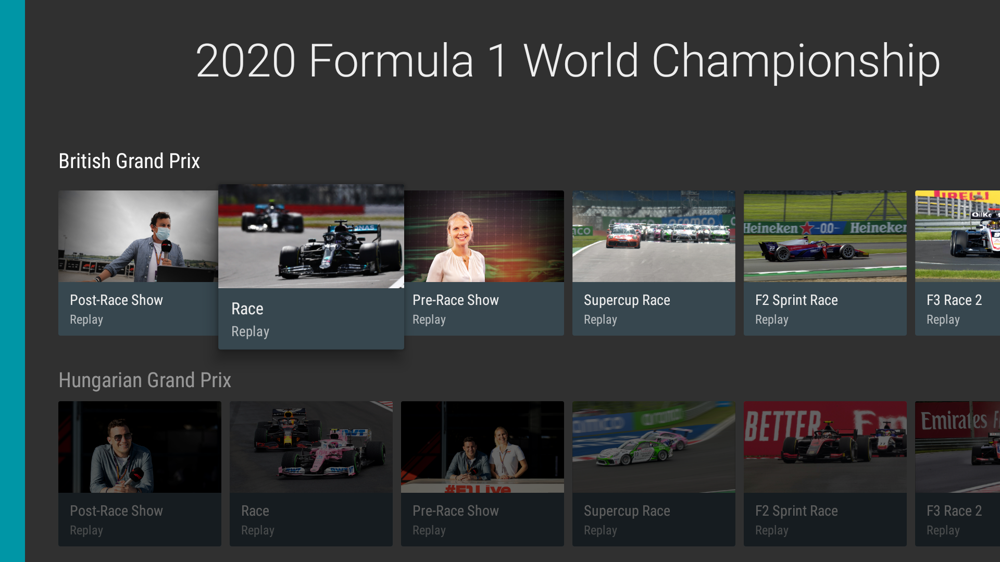
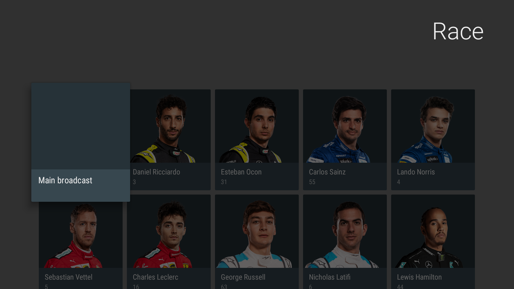
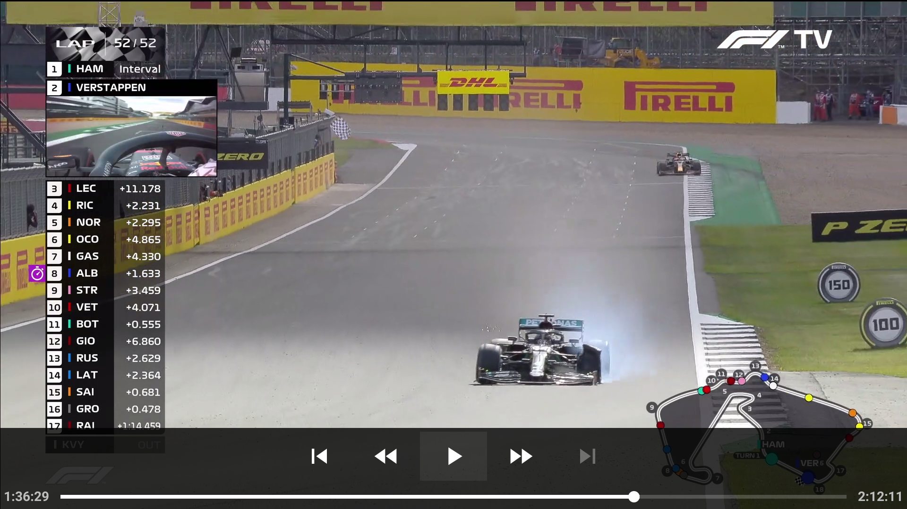
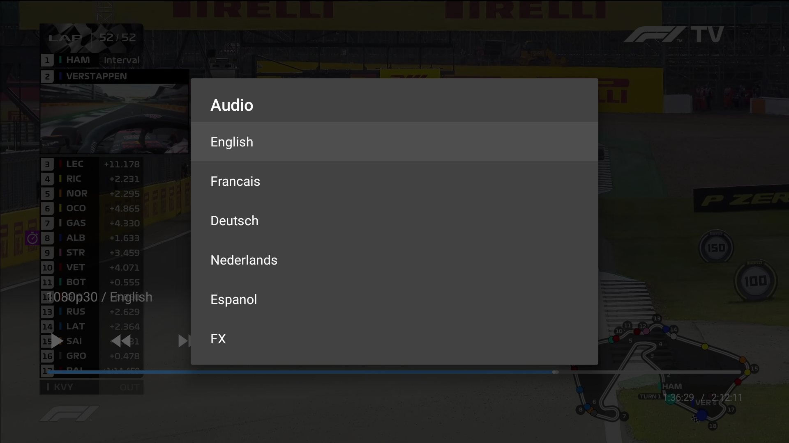

# Race Control TV

Android TV client for watching F1 TV content with a remote-friendly Leanback UI.

This repository is an updated fork focused on current Android TV devices, local sideload installs, and up-to-date playback behavior. It is not affiliated with Formula 1 or F1 TV.

## What It Does

- Browse current and archived sessions.
- Play main feeds, onboard cameras, tracker/data channels, and other multi-channel session feeds when F1 TV exposes them.
- Support multiple audio tracks, including commentary-free feeds when available.
- Show and switch video quality from the player controls.
- Display the active video quality and audio language in the playback overlay.
- Support subtitles/closed captions when provided by the upstream stream.
- Support custom radio audio injection with adjustable sync delay.
- Use a TV-first sign-in flow instead of requiring a browser on another device.

## Playback Notes

- Playback capability depends on what F1 TV returns for a given session, region, account tier, and device path.
- The app can use higher-quality streams, including 50 fps content and 4k HDR variants, when your subscription is eligible and the device can decode them.
- If a preferred playback path fails, the app falls back to more widely compatible stream variants automatically.

## Requirements

- An Android TV or Google TV device running Android 9+.
- A valid F1 TV subscription with access to the content you want to watch.
- Sideloading enabled if you are installing the APK manually.

## Legal Notice

- This is an unofficial, independent project. It is not affiliated with, endorsed by, or sponsored by Formula 1, Formula One Licensing, F1 TV, Tiledmedia, Grand Prix Radio or any broadcaster. "F1" and "F1 TV" are trademarks of their respective owners.
- The app only plays content from your own, valid F1 TV subscription, and only through the player and DRM (Widevine) of your own device. It does not bypass, spoof or weaken DRM, and it does not contain F1 code, keys or content. Using a third-party client may be against the F1 TV terms of use; you use it at your own risk and responsibility.
- **Custom radio:** the source code contains no radio stream URL; you can enter your own (`CUSTOM_RADIO_URL` or the setting), and you are responsible for that stream and the rights to it. Distributed builds may come with the third-party stream *Grand Prix Radio* preconfigured as a convenience. That is a separate service, not owned, hosted, endorsed or controlled here and not affiliated with this project; its own terms apply, and it can be removed or replaced at any time.
- The software is provided "as is" under the license in [LICENSE](LICENSE): st14n's own source-available license for the changes made in this fork, while the upstream MIT-licensed code keeps its MIT license. No warranty and no liability.
- Rights holders who object to something in this repository can open an issue and it will be looked at promptly.

## Install

This project is distributed as a sideloaded APK. It is not maintained through the Play Store.

### Prebuilt APK

Download a release APK from your distribution point of choice and sideload it with ADB or your preferred TV installer.

### Build And Install From Source

1. Install JDK 21.
2. Install the Android SDK and platform tools.
3. Clone the repository.
4. Optionally create a `.env` file in the project root for build-time defaults (see below).
5. Use one of the Gradle install tasks below.

```powershell
.\gradlew.bat :app:installDebug
.\gradlew.bat :app:installRelease
```

If no custom release signing properties are configured, the release build falls back to the debug keystore so it remains installable for local testing.

## Optional `.env` Values

The app can read a few build-time defaults from a root `.env` file:

```dotenv
F1_username=
F1_password=
TOKEN_REFRESH_INTERVAL_MS=
CUSTOM_RADIO_URL=
```

These are optional. The normal flow is still signing in on device and changing settings from the app UI.

## Development

### Toolchain

- Android Gradle Plugin based project with Kotlin DSL.
- Kotlin + Coroutines.
- Hilt for dependency injection.
- Moshi for JSON.
- Room for local persistence.
- Media3 / ExoPlayer for playback.
- JavaCV / FFmpeg for in-app custom radio normalization.

### Useful Commands

```powershell
.\gradlew.bat :app:assembleDebug
.\gradlew.bat :app:assembleRelease
.\gradlew.bat :app:compileDebugKotlin
.\gradlew.bat :app:installDebug
.\gradlew.bat :app:installRelease
```

## Current App Features

- TV-native sign-in screen with saved credentials.
- Home screen focused on current season and available sessions.
- Session screen with per-channel browsing for onboard and data feeds.
- Playback controls for seek, audio track selection, channel switching, quality selection, subtitles, and custom radio sync.
- App language options for English, German, Spanish, French, Dutch, Polish, Portuguese, Russian, or system default.

## Limitations

- This app only plays streams and metadata that F1 TV currently exposes to the authenticated account.
- Availability of subtitles, alternate audio, onboard feeds, HDR, or higher resolutions varies by session, subscription and device.
- Buffering or stream-rule failures are often upstream service issues rather than local player bugs.
- Changes on the F1 TV side can break playback without warning.

## Screenshots











## Credits

Thanks to [Groggy](https://github.com/Groggy), the original creator of the project this fork builds on.

Thanks to the contributors to [f1viewer](https://github.com/SoMuchForSubtlety/f1viewer) for the public groundwork around F1 TV API behavior.

Thanks to [Thiago Andrade](https://github.com/ttandrade) for the icon and visual design work carried forward in the project.

Thanks to [Leonardo Rossetto](https://github.com/leonardoxh) for his earlier work this fork was built on.

Thanks to [LoVega1337](https://github.com/LoVega1337) and [Loïc Yhuel](https://github.com/hwti) for their knowledge about the 4K/HDR manifest. 