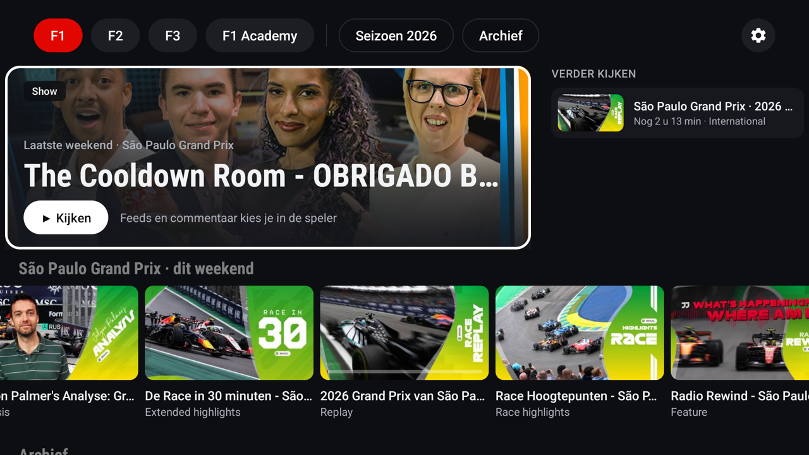
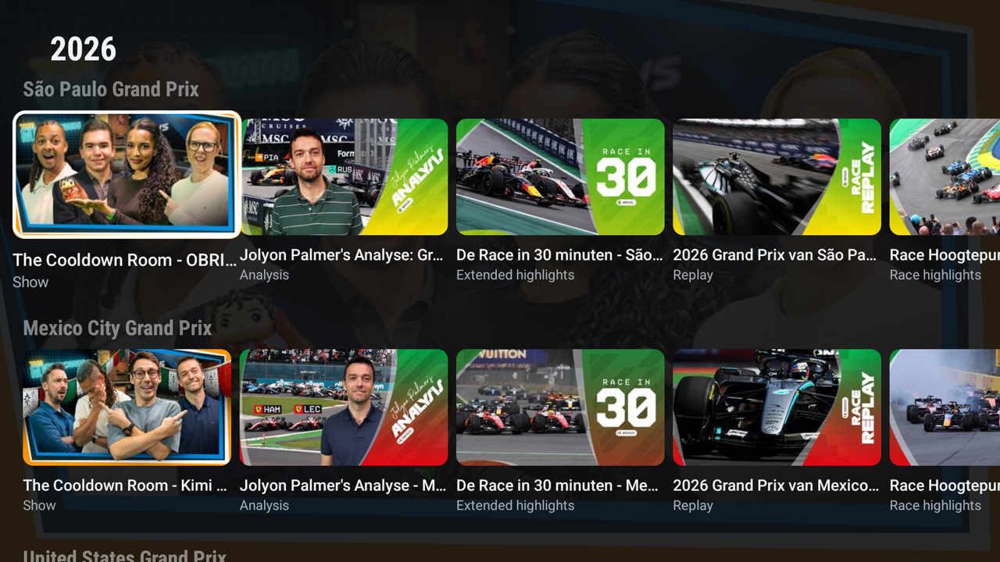
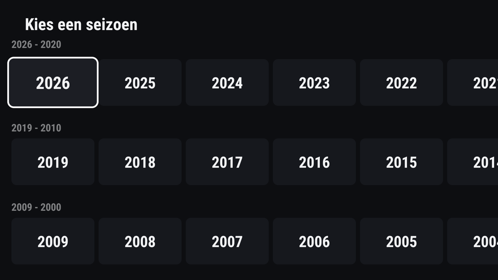
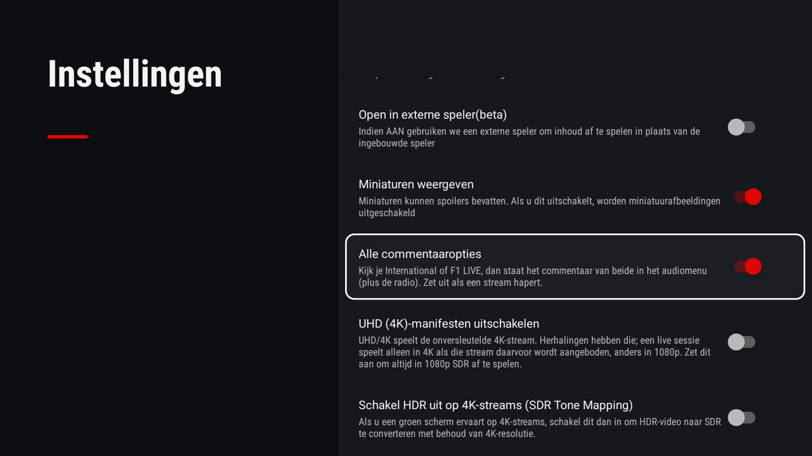

# Race Control TV

Android TV client for watching F1 TV content with a remote-friendly interface. It also runs on Android phones.

This repository is an updated fork focused on current Android TV devices, local sideload installs, and up-to-date playback behavior. It is not affiliated with Formula 1 or F1 TV.

## What It Does

- **Home screen:** buttons for each class (F1, F2, F3, F1 Academy), the current season and the archive. Below them:
  - a big card for the newest race weekend (selected automatically when a new weekend starts);
  - "Continue watching", with replays you stopped halfway;
  - the sessions of that weekend.
- **Season and archive screens:** browse every season of the selected class, one row per race weekend.
- **Feeds:** International, F1 LIVE, Tracker, Data, Pit Lane and the onboard cameras, when F1 TV offers them. The feed picker in the player shows the main feeds as tiles and the onboards in team colours.
  - The feed that plays is marked.
  - Switching feed in a replay continues at the same moment.
- **Commentary:** every audio track of the stream.
  - International and F1 LIVE also offer each other's commentary, so all languages, F1 LIVE's commentary and the circuit-only (FX) track are in one menu.
  - English and Spanish say which feed they come from.
- **Quality:** 4K HDR replays from F1's unencrypted 4K stream. The current quality, feed and audio are shown in the player.
- **Continue watching:** replays remember where you stopped, and the cards show how far you got.
- **Custom radio:** play your own radio stream instead of the TV commentary.
  - The radio is synced with the picture automatically, by comparing the circuit sound.
  - Two buttons in the player move it 0.5 s earlier or later.
- **Player menus:** they open as a panel at the side (at the bottom on a phone), so the picture stays visible.
- **Other:** subtitles when the stream has them. Sign-in works on the TV itself, without a browser on another device. The app is in Dutch and English.

## Playback Notes

- Playback capability depends on what F1 TV returns for a given session, region, account tier and device.
- **4K/UHD:** replays play F1's unencrypted 4K HDR stream (the same one F1's own TV app plays).
  - If F1 renames that stream, the app tries the names that follow F1's naming scheme. It uses a stream only after checking that it really is unencrypted 4K/HDR, and remembers the one that works.
  - Live sessions play in 4K only when F1 offers that stream for them, otherwise in 1080p. This has not been verified live yet.
  - "Disable UHD (4K) manifests" in Settings always plays 1080p SDR.
- If a preferred playback path fails, the app falls back to more widely compatible stream variants automatically.
- **Radio sync:** tuned on recorded race audio, not yet on a live radio stream.

## Requirements

- An Android TV or Google TV device running Android 9+ (Fire TV devices and Android phones should work too, but are less tested).
- A valid F1 TV subscription with access to the content you want to watch.
- Sideloading enabled if you are installing the APK manually.

## Legal Notice

- This is an unofficial, independent project. It is not affiliated with, endorsed by, or sponsored by Formula 1, Formula One Licensing, F1 TV, Tiledmedia, Grand Prix Radio or any broadcaster. "F1" and "F1 TV" are trademarks of their respective owners.
- The app only plays content from your own, valid F1 TV subscription, and only through the player and DRM (Widevine) of your own device. It does not bypass, spoof or weaken DRM, and it does not contain F1 code, keys or content. Using a third-party client may be against the F1 TV terms of use; you use it at your own risk and responsibility.
- **Custom radio:** the source code contains no radio stream URL; you can enter your own (`CUSTOM_RADIO_URL` or the setting), and you are responsible for that stream and the rights to it. Distributed builds may come with the third-party stream *Grand Prix Radio* preconfigured as a convenience. That is a separate service, not owned, hosted, endorsed or controlled here and not affiliated with this project; its own terms apply, and it can be removed or replaced at any time.
- The software is provided "as is" under the license in [LICENSE](LICENSE): st14n's own source-available license for the changes made in this fork, while the upstream MIT-licensed code keeps its MIT license. No warranty and no liability.
- Rights holders who object to something in this repository can open an issue and it will be looked at promptly.

## Install

This project is distributed as a sideloaded APK. It is not maintained through the Play Store.

### Prebuilt APK

Download the latest APK from [Releases](https://github.com/st14n/race-control-tv/releases) and sideload it with ADB or your preferred TV installer. Each release has two APKs:

- `-radio`: a third-party radio stream is preconfigured (see the Legal Notice).
- `-standard`: no radio stream. You can enter your own in Settings.

Neither contains an F1 account; you sign in on the device. The app checks for new releases and offers to install them.

### Build And Install From Source

1. Install JDK 21.
2. Install the Android SDK and platform tools.
3. Clone the repository.
4. Optionally create a `.env` file in the project root for build-time defaults (see below).
5. Use one of the Gradle install tasks below.

```powershell
.\gradlew.bat :app:installDebug
.\gradlew.bat :app:installRelease
```

If no custom release signing properties are configured, the release build falls back to the debug keystore so it remains installable for local testing.

## Optional `.env` Values

The app can read a few build-time defaults from a root `.env` file:

```dotenv
F1_username=
F1_password=
TOKEN_REFRESH_INTERVAL_MS=
CUSTOM_RADIO_URL=
```

Gradle switches: `-Pf1.cleanBuild=true` leaves the account out of the APK (releases are built this way), `-Pf1.noRadio=true` leaves out the preconfigured radio stream, `-Pf1.defaultLanguage=nl|en|auto` sets the language used until you choose one in Settings (the app is translated into Dutch and English; other languages fall back to English).

These are optional. The normal flow is still signing in on device and changing settings from the app UI.

## Development

### Toolchain

- Android Gradle Plugin based project with Kotlin DSL.
- Kotlin + Coroutines.
- Hilt for dependency injection.
- Moshi for JSON.
- Room for local persistence.
- Media3 / ExoPlayer for playback.
- JavaCV / FFmpeg for in-app custom radio normalization.

### Useful Commands

```powershell
.\gradlew.bat :app:assembleDebug
.\gradlew.bat :app:assembleRelease
.\gradlew.bat :app:compileDebugKotlin
.\gradlew.bat :app:installDebug
.\gradlew.bat :app:installRelease
```

## Current App Features

- TV-native sign-in screen with saved credentials.
- Home screen with class buttons, the newest weekend, continue watching and the archive.
- Feed picker with the main feeds and the onboard cameras.
- Playback controls for seeking, audio, feed switching, quality, subtitles and the custom radio (sync menu plus quick earlier/later buttons).
- Settings for playback, 4K/HDR, the radio and the app language (Dutch, English or the system language).

## Limitations

- 4K for live sessions is unverified (see Playback Notes).
- Continue watching covers replays of the current season.
- This app only plays streams and metadata that F1 TV currently exposes to the authenticated account.
- Availability of subtitles, alternate audio, onboard feeds, HDR, or higher resolutions varies by session, subscription and device.
- Buffering or stream-rule failures are often upstream service issues rather than local player bugs.
- Changes on the F1 TV side can break playback without warning.

## Screenshots

Home screen: class buttons, the newest weekend, continue watching and the sessions of the weekend.



A season, one row per race weekend.



The archive.



Settings.



The player cannot be captured with a screenshot: the video plays on a protected surface, so Android leaves it out of screenshots.

## Credits

Thanks to [Groggy](https://github.com/Groggy), the original creator of the project this fork builds on.

Thanks to the contributors to [f1viewer](https://github.com/SoMuchForSubtlety/f1viewer) for the public groundwork around F1 TV API behavior.

Thanks to [Thiago Andrade](https://github.com/ttandrade) for the icon and visual design work carried forward in the project.

Thanks to [Leonardo Rossetto](https://github.com/leonardoxh) for his earlier work this fork was built on.

Thanks to [LoVega1337](https://github.com/LoVega1337) and [Loïc Yhuel](https://github.com/hwti) for their knowledge about the 4K/HDR manifest. 